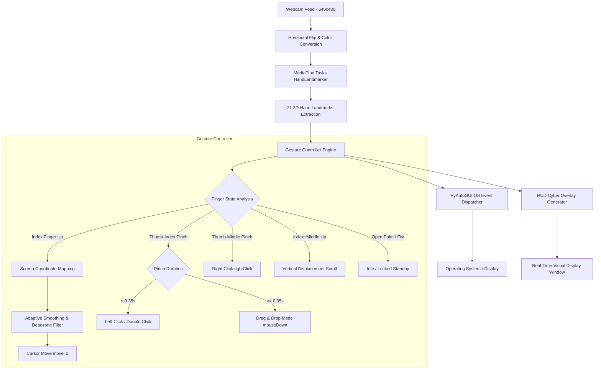

# AI Hand Gesture Virtual Mouse 🖱️🖐️
> **B-Tech Semester 5 Artificial Intelligence Project**  
> Real-Time Touchless Human-Computer Interaction (HCI) using Computer Vision & Deep Learning.

---

## 📌 1. Project Overview

The **AI Hand Gesture Virtual Mouse** is an intelligent vision-based system that transforms your computer's standard webcam into an optical hand-tracking input device. By tracking 21 3D hand landmarks in real time and classifying spatial gestures, it allows users to navigate the mouse cursor, perform single clicks, double clicks, right clicks, drag-and-drop, and scroll through pages—**completely touchless**.

### Key Highlights:
- **Zero Additional Hardware**: Works with standard laptop or USB webcams (30–60 FPS).
- **Adaptive Velocity Smoothing (EMA)**: Eliminates natural human hand tremors and micro-shakes while preserving near-zero latency when moving rapidly across the screen.
- **Active Interaction Zone**: Sub-region camera bounding box mapped linearly to the entire monitor screen resolution (e.g., 1920x1080), eliminating hand strain at screen borders.
- **Biomechanical Pinch Accuracy**: Uses Thumb-to-Index pinch for clicking, which eliminates cursor displacement during clicks.
- **Futuristic Head-Up Display (HUD)**: Sleek cyberpunk HUD with dynamic state badges, real-time FPS counter, distance telemetry gauge, and on-screen gesture cheatsheet.

---

## 🛠️ 2. System Architecture



---

## ✋ 3. Gesture Mapping & Controls

| Gesture | Hand Pose | Action | Technical Description |
| :--- | :--- | :--- | :--- |
| **Move Cursor** | ☝️ Index Finger Extended | **Cursor Motion** | Maps landmark 8 to screen coords via adaptive EMA smoothing. |
| **Left Click** | 🤏 Thumb + Index Pinch | **Single Click** | Pinch distance < 32px for < 0.35s. |
| **Double Click** | 🤏🤏 Double Pinch | **Double Click** | Two consecutive pinches within 0.35s interval. |
| **Drag & Drop** | 🤏 (Hold) Pinch & Move | **Click & Drag** | Hold pinch > 0.35s (`mouseDown`), move, release to drop (`mouseUp`). |
| **Right Click** | 🤌 Thumb + Middle Pinch | **Right Click** | Middle fingertip (12) pinched to Thumb tip (4). |
| **Scroll Pages** | ✌️ Index + Middle Extended | **Scroll Up / Down** | Relative vertical displacement drives wheel velocity. |
| **Neutral Standby** | 🖐️ All 5 Fingers Open | **Idle / Hover** | Prevents unintended clicks while speaking or resting. |
| **Cursor Lock** | ✊ Closed Fist | **Freeze Cursor** | Locks mouse at current position. |

### Keyboard Shortcuts:
- **`M` or `P`**: Pause / Resume AI mouse tracking.
- **`H`**: Toggle on-screen gesture manual cheat sheet.
- **`S`**: Toggle auditory click feedback beep.
- **`C`**: Re-center cursor to screen midpoint (960, 540).
- **`Q` or `ESC`**: Clean shutdown.

---

## 📐 4. Mathematical & Algorithmic Formulation

### 1. Active Coordinate Normalization & Bilinear Interpolation
To avoid hand strain at the webcam borders, the interaction area is bounded by $[x_{min}, x_{max}]$ and $[y_{min}, y_{max}]$:
$$X_{screen} = \text{interp}(x_{index}, [x_{min}, x_{max}], [0, W_{screen}])$$
$$Y_{screen} = \text{interp}(y_{index}, [y_{min}, y_{max}], [0, H_{screen}])$$

### 2. Adaptive Exponential Moving Average (EMA) Smoothing
Human hands have physiological micro-tremors (3–5 Hz). When distance $\Delta = \sqrt{(X_{target} - X_{prev})^2 + (Y_{target} - Y_{prev})^2} < \tau_{deadzone}$, position updates are suppressed.
For $\Delta \ge \tau_{deadzone}$, the dynamic smoothing factor $\alpha(\Delta)$ scales adaptively:
$$\alpha(\Delta) = \text{interp}(\Delta, [\Delta_{slow}, \Delta_{fast}], [S_{max}, S_{min}])$$
$$X_{curr} = X_{prev} + \frac{X_{target} - X_{prev}}{\alpha(\Delta)}$$

### 3. Palm-Scale Normalized Euclidean Pinch Metric
To make pinch detection invariant to the user's distance from the camera:
$$S_{palm} = \|\mathbf{p}_{9} - \mathbf{p}_{0}\|_2$$
$$d_{\text{norm}}(4, 8) = \|\mathbf{p}_8 - \mathbf{p}_4\|_2 \times \frac{S_{\text{ref}}}{S_{palm}}$$
where $\mathbf{p}_0$ is the wrist landmark, $\mathbf{p}_9$ is the middle finger MCP base, and $S_{\text{ref}} = 95\text{px}$.

### 4. Schmitt-Trigger Hysteresis Debouncing
To prevent contact flutter / click-chatter at threshold boundaries:
$$\text{Threshold} = \begin{cases} T_{\text{click}} + \Delta_{\text{release}}, & \text{if already pinched (holding)} \\ T_{\text{click}}, & \text{if idle} \end{cases}$$

---

## 🚀 5. How to Run the Project

### Option A: One-Click Execution (Windows)
Double-click the included launcher:
```bat
run.bat
```

### Option B: Terminal Execution
1. Open PowerShell or Command Prompt in the project folder:
   ```powershell
   .\venv\Scripts\python main.py
   ```

---

## 📁 6. Project Directory Structure

```
AI project/
├── config.py                 # Configuration parameters, thresholds & themes
├── hand_tracking.py          # MediaPipe HandLandmarker wrapper & 21-joint skeleton
├── gesture_controller.py     # State machine, smoothing & OS mouse event engine
├── ui_hud.py                 # Futuristic cyberpunk HUD & gesture cheatsheet
├── main.py                   # Main real-time pipeline execution loop
├── requirements.txt          # Pinned dependency requirements
├── run.bat                   # 1-click Windows launcher
├── hand_landmarker.task      # MediaPipe neural network model asset
└── README.md                 # Project documentation & viva presentation guide
```

---

## 🎓 7. Academic Viva & Presentation Q&A

**Q1: Why use MediaPipe Tasks HandLandmarker over classic Haar cascades or contour detection?**  
*Answer:* Haar cascades and contour color segmentation fail under varying lighting, skin tones, and complex backgrounds. MediaPipe utilizes a two-stage deep learning pipeline (Palm Detector followed by a 21 3D Landmark Regression model) that operates with high accuracy, sub-pixel precision, and runs at 30+ FPS directly on CPU using TensorFlow Lite XNNPACK delegates.

**Q2: How is the cursor jitter problem solved?**  
*Answer:* Cursor jitter is addressed via a dual-layer stabilization algorithm:
1. *Deadzone Thresholding:* Micro-movements below 3.5 pixels are filtered out completely so the cursor stays perfectly still during clicks.
2. *Velocity-Adaptive EMA:* When moving slowly for fine aiming, the smoothing factor increases (up to 8.0) for stability. When moving rapidly, the smoothing factor decreases (down to 1.8) for immediate responsiveness.

**Q3: Why is pinching (Thumb to Index) preferred over two-finger extension for clicking?**  
*Answer:* Biomechanically, extending a second finger (like the middle finger) tenses the extensor digitorum muscle, invariably causing the index finger to twitch and shift the cursor before the click registers. Pinching moves the thumb towards the stationary index finger, ensuring the cursor remains fixed precisely over the targeted UI element.

**Q4: How does the system adapt when the user sits closer or further from the camera?**  
*Answer:* We implement Palm-Scale Normalization using the Euclidean distance between the wrist (Landmark 0) and the Middle MCP joint (Landmark 9) as an anthropometric reference. Pinch distances are scaled proportionally ($d_{\text{norm}} = d \cdot \frac{S_{\text{ref}}}{S_{\text{palm}}}$), ensuring identical sensitivity regardless of camera distance or user hand size.

**Q5: What is the Anti-Slip Click Anchor and Hysteresis Filter?**  
*Answer:* 
1. *Anti-Slip Anchor:* When a pinch begins, the cursor coordinates are temporarily frozen at the pinch inception point during the click decision window ($< 0.35$s). If the pinch is released (single click), the click triggers exactly on target without slipping off tiny UI buttons.
2. *Hysteresis Filter:* A Schmitt-trigger band (+10px buffer) prevents rapid oscillation and double-click glitches when the fingers hover near the boundary threshold.
